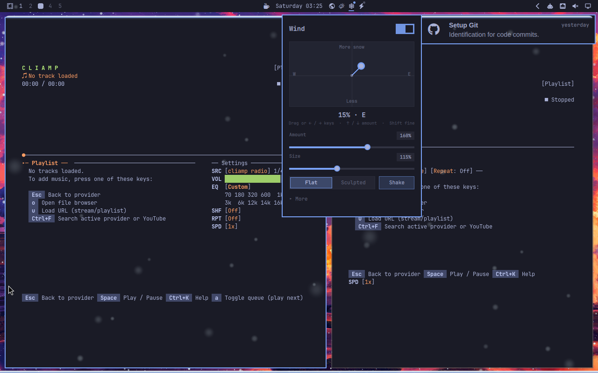

# SnowFx

Atmospheric snow for the Omarchy desktop, drawn entirely by GPU shaders (no textures, no CPU particles).

- **Amount & Size** – `particleAmount` (0.1–2.5) really changes how many flakes spawn (extra offset passes above 1.0), `particleSize` (0.5–2.2) scales flake radius. Both are independent of snow buildup. Six dense parallax planes sit behind windows, plus two subtle foreground planes.
- **Behind your windows** – multi-depth parallax snow drifts over the wallpaper, so terminal and editor text stays readable.
- **On top of your windows** – shaded, rounded snowdrifts settle on window top edges (following Hyprland's corner rounding), plus a sparse layer of soft foreground bokeh flakes. Drifts shed instantly when a window moves, resizes, closes or changes workspace.
- **Wind popover** – click the snowflake in the bar: drag the pad left/right for wind strength and direction (`83% · W`), up/down for particle amount. Reset returns to calm.
- **Gradual accumulation** – each window builds snow over ~30 s (faster with higher density/snowfall). Drift style is `flat` (level layer, rounded shoulders) or `sculpted` (wind-carved ridges leaning downwind).
- **Shake-off physics** – closing a snowy window drops its snow as falling clumps and powder; dragging or resizing a window sheds 35–55% of it. **Shake** (button or IPC) sheds everything like a snowglobe.
- **Workspace whoosh** – switching workspaces kicks up a brief wind gust. An optional thin snowbank builds along each monitor's bottom edge.
- Click-through on every monitor, tints itself from the active Omarchy theme, and drops to 0 FPS when disabled or when a monitor has a fullscreen window.

## Install / remove

    omarchy plugin add https://github.com/neshath/omarchy-snowfx.git --enable
    omarchy plugin remove io.github.neshath.snowfx

Then add the snowflake widget to your bar from the shell's widget settings.

## Requirements

None beyond Omarchy's built-in stack (Omarchy 4.5 shell on Quickshell/Qt 6, Hyprland). Shaders ship precompiled, so there is nothing to build or install.

## Settings

Stored in `~/.config/omarchy/snowfx.json`: `enabled`, `drifts` (window snow), `density` (buildup, 0.1–1), `windX` (-1 W … 1 E), `particleAmount` (0.1–2.5), `particleSize` (0.5–2.2), `driftStyle` (`flat` | `sculpted`), `workspaceGust`, `bottomBank`, `fps` (30 or 60).

## IPC / keybinds

    qs ipc call snowfx toggle
    qs ipc call snowfx setWind <x -1..1> <amount 0.1..2.5>
    qs ipc call snowfx setAmount <0.1-2.5>
    qs ipc call snowfx setSize <0.5-2.2>
    qs ipc call snowfx setFlow <amount>      # alias of setAmount
    qs ipc call snowfx windLeft              # nudge wind -0.15 (west)
    qs ipc call snowfx windRight             # nudge wind +0.15 (east)
    qs ipc call snowfx nudgeWind <delta>     # e.g. -0.05
    qs ipc call snowfx resetWind
    qs ipc call snowfx clearSnow             # silently reset all accumulation
    qs ipc call snowfx shake                 # snowglobe shake: bursts + gust, accumulation to 0
    qs ipc call snowfx gust                  # a brief random wind gust
    qs ipc call snowfx setDriftStyle <flat|sculpted>
    qs ipc call snowfx status

In the popover: drag the pad, or use ← / → (wind), ↑ / ↓ (amount), Shift for fine steps, `0` / `R` to reset.

Optional `~/.config/hypr/bindings.lua` entries (pick keys that are free in your setup; SnowFx never edits your Hyprland config):

    o.bind("SUPER + CTRL + ALT + Left", "Snow wind west", hl.dsp.exec_cmd("qs ipc call snowfx windLeft"), { repeating = true })
    o.bind("SUPER + CTRL + ALT + Right", "Snow wind east", hl.dsp.exec_cmd("qs ipc call snowfx windRight"), { repeating = true })
    o.bind("SUPER + CTRL + ALT + S", "Toggle snow", hl.dsp.exec_cmd("qs ipc call snowfx toggle"))
    o.bind("SUPER + CTRL + ALT + H", "Shake snow", hl.dsp.exec_cmd("qs ipc call snowfx shake"))
    o.bind("SUPER + CTRL + ALT + C", "Clear snow", hl.dsp.exec_cmd("qs ipc call snowfx clearSnow"))

Legacy `hyprland.conf` equivalent (`binde` repeats while held):

    binde = SUPER CTRL ALT, Left, exec, qs ipc call snowfx windLeft
    binde = SUPER CTRL ALT, Right, exec, qs ipc call snowfx windRight

## Shaders

`shaders/*.frag` are original GLSL 440 sources; `.frag.qsb` are precompiled with `scripts/compile-shaders.sh` (contributors only; users need no build tools).

## License

[MIT](LICENSE) © neshath
